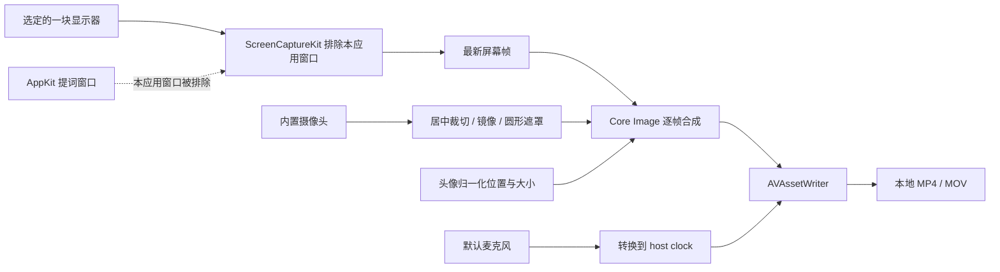

# 架构与数据流

CircleCast 使用 Apple 原生框架实现一次本地录制，不依赖服务端。



## 主要模块

| 文件 | 职责 |
| --- | --- |
| `Sources/CircleCast/App.swift` | 主窗口、菜单栏、显示器选择、导出和睡眠/屏幕变化处理 |
| `Sources/CircleCast/OverlayWindows.swift` | 圆形摄像头预览、拖动/缩放、提词器与本地偏好保存 |
| `Sources/CircleCast/Recorder.swift` | 权限、启动顺序、设备会话、屏幕流、停止和取消协调 |
| `Sources/CircleCast/CapturePipeline.swift` | 串行媒体队列、最新帧、定时合成、音频时间戳和写入器调度 |
| `Sources/CircleCastCore/Geometry.swift` | 屏幕坐标归一化、边界限制、输出尺寸、状态转换门 |
| `Sources/CircleCastCore/Compositor.swift` | 裁切、镜像、圆形遮罩、描边和最终像素合成 |
| `Sources/CircleCastCore/MovieWriter.swift` | H.264/AAC 写入、时间线、背压统计、完成与取消 |

## 队列与时间线

- UI 在主线程；耗时的设备启动/停止在单独设备队列。
- 媒体回调、合成定时器与写入器共用串行媒体队列。头像几何值通过带锁的 `OverlayState` 传递。
- 保存最新屏幕和摄像头缓冲区，定时以目标 30 fps 重新合成。因此不依赖桌面变化来触发头像更新。
- 首个合成画面建立写入时间线。麦克风时间戳从采集会话时钟转换到 host clock，忽略首帧之前的音频。
- 写入器不可接收数据时丢弃相应帧/音频段并计数，不建立无限视频帧队列。实际高负载行为仍需测量。

## 坐标与输出

UI 使用 AppKit 全局左下原点坐标。减去所选显示器原点后做归一化，合成时换算到输出像素。几何测试覆盖负原点、四角、竖屏和缩放限制；真实多屏和 Retina 显示效果另行验收。

输出最长边不超过 1920，保持屏幕比例并使用偶数尺寸；编码为 SDR H.264 视频和 48 kHz 单声道 AAC 音频。摄像头优先配置 720p。

## 提词和预览排除

本应用的 `SCRunningApplication` 通过进程 ID 确认，传入 `SCContentFilter(display:excludingApplications:exceptingWindows:)`。如果无法确认本应用，启动会失败，避免在不确定的排除范围下继续。

头像由摄像头原始缓冲区合成，不依赖把头像窗口录进屏幕。合成器只接收屏幕、摄像头及位置；不接收文稿。真实系统捕获的过滤效果仍未完成端到端验证。

## 生命周期

```text
idle → requesting → countdown → preparing → recording → stopping → idle
```

启动请求仅在 idle 时接受。启动失败、取消、设备中断和停止都进入清理路径；停止定时器和接收回调，停止屏幕流并移除输出，解绑预览，停止设备会话并移除输入输出，然后结束或取消写入器。

单元测试覆盖状态转换和写入器释放；真实设备释放、系统授权窗口、外接屏变化与长时间音画同步仍需实际验证。

## 参考文档

- [Apple ScreenCaptureKit](https://developer.apple.com/documentation/screencapturekit)
- [Meet ScreenCaptureKit](https://developer.apple.com/videos/play/wwdc2022/10156/)
- [AVCaptureSession](https://developer.apple.com/documentation/avfoundation/avcapturesession)
- [AVAssetWriter](https://developer.apple.com/documentation/avfoundation/avassetwriter)

这些是 API 参考链接；仓库没有复制 Apple SDK 或示例工程。
